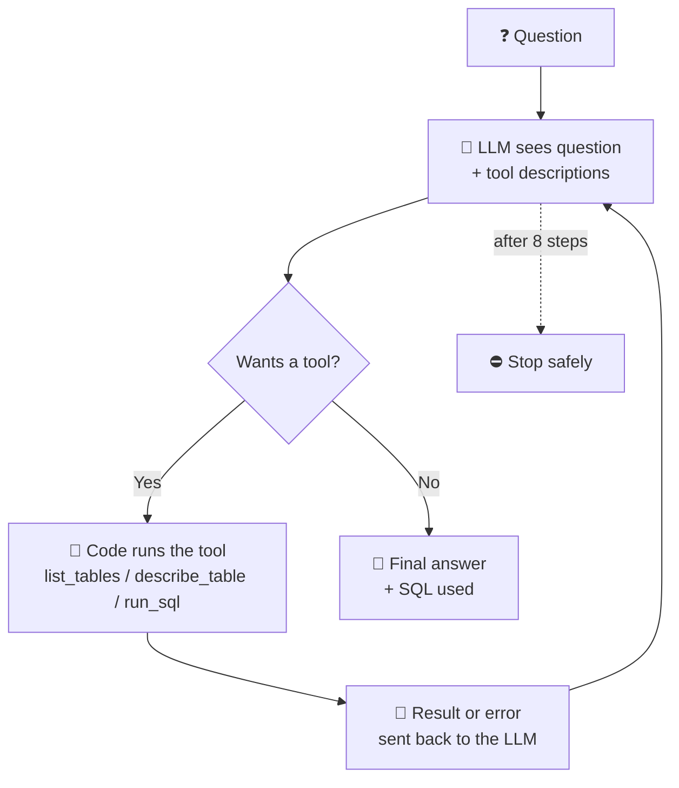
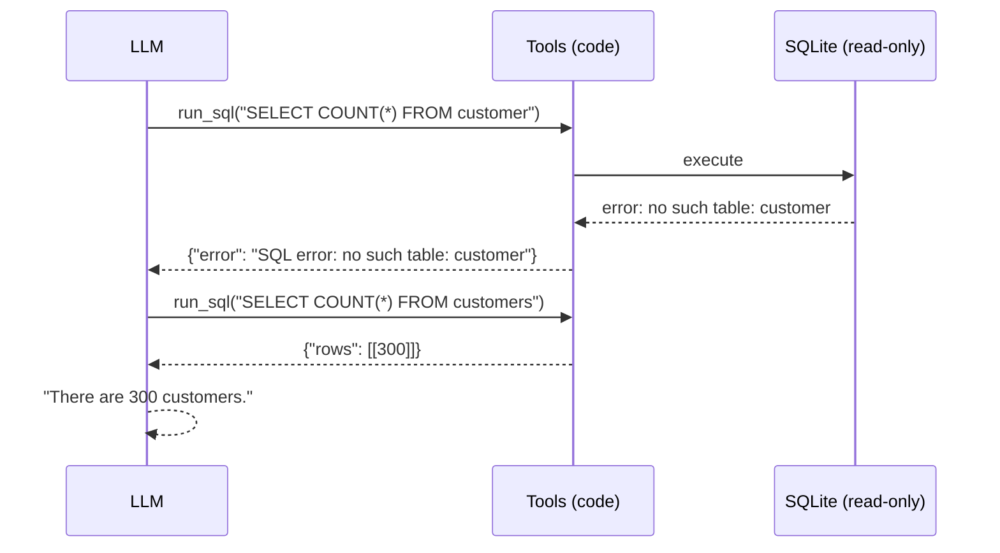
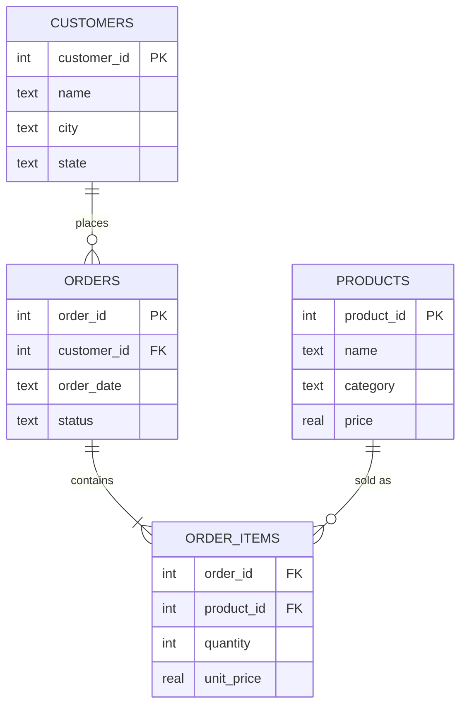

<div align="center">

# 🤖 SQL Analyst Agent

**An AI agent that answers questions about a database in plain English. It explores the schema, writes SQL, runs it, fixes its own mistakes, and shows the query it used.**


-black)
-D97757)


</div>

---

## 💡 What it does

*Illustrative run (your exact steps depend on the model):*

```
❓ Which product generated the most revenue from completed orders?
🔧 Agent steps:
  [1] ✓ list_tables({})
  [2] ✓ describe_table({"table": "order_items"})
  [3] ✓ describe_table({"table": "products"})
  [4] ✓ run_sql({"query": "SELECT p.name, SUM(oi.quantity*oi.unit_price) ... LIMIT 1"})

💬 The 27-inch Monitor generated the most revenue.
   SQL used: SELECT p.name, SUM(oi.quantity * oi.unit_price) AS revenue FROM order_items oi ...
```

People without SQL skills can get answers from data. Everyone can see **how** each answer was produced.

---

## 🔄 How it works

### The agent loop



### Self-correction



### Tools

| Tool | What it does |
|---|---|
| `list_tables` | Lists the tables in the database |
| `describe_table` | Columns, types and 3 sample rows |
| `run_sql` | Runs one read-only SELECT, returns up to 50 rows |

---

## 🛡️ Guardrails (enforced in code, not just the prompt)

| Risk | Protection |
|---|---|
| Agent deletes or changes data | Database opened **read-only** (`mode=ro`); write keywords rejected |
| Multiple or sneaky statements | Only **one** `SELECT`/`WITH` statement allowed |
| Huge results | Capped at **50 rows** (flagged as truncated) |
| Slow / runaway queries | **3-second** time limit per query |
| Infinite loop | Stops after **8 steps** |
| Model/network failure | Returns a clear error instead of crashing |
| Made-up numbers | Prompt requires answers only from query results, and shows the SQL used |

---

## 🚀 Quick start (free, runs on your laptop)

```bash
# 1. Install Ollama (https://ollama.com) and a tool-capable model
ollama pull qwen2.5:7b

# 2. Set up the project
python3 -m venv .venv && source .venv/bin/activate
pip install -r requirements.txt
python -m agent.sample_db                  # creates data/shop.db

# 3. Use it
python -m agent.cli "Which product generated the most revenue?"
python -m agent.cli                        # interactive mode

# 4. Test and evaluate
pytest -q                                  # 18 tests, no LLM needed
python eval/run_eval.py                    # 12 questions with checked answers
```

<details>
<summary><b>Use Claude instead of Ollama</b></summary>

```bash
pip install anthropic
export ANTHROPIC_API_KEY=sk-ant-...
LLM_BACKEND=claude python -m agent.cli "How many orders were cancelled?"
```

</details>

<details>
<summary><b>Try a different local model</b></summary>

```bash
ollama pull llama3.1
OLLAMA_MODEL=llama3.1 python eval/run_eval.py
```

</details>

---

## 📊 Evaluation

`eval/questions.json` has **12 questions**: counts, revenue, top products, date filters, joins across 3–4 tables. Each correct answer is computed directly from the database with a hand-written "gold" SQL query, then the agent's answer is checked against it (0.5% tolerance for rounding).

The report shows **accuracy**, **average tool calls**, and **self-corrections** (answers that were right after a failed query).

| Model | Accuracy | Avg tool calls |
|---|:-:|:-:|
| qwen2.5:7b (Ollama) | *run `python eval/run_eval.py`* | |

---

## 🗄️ Sample database

A small, deterministic e-commerce store (2026 data):



300 customers · 15 products · 2,000 orders · statuses: completed / cancelled / refunded

---

## 📁 Project structure

```
sql-agent/
├── agent/
│   ├── agent.py       🧠 the agent loop (think → tool → observe → repeat)
│   ├── tools.py       🔧 tools + guardrails (read-only, row cap, timeout)
│   ├── llm.py         🔌 Ollama / Claude / scripted backends, one interface
│   ├── sample_db.py   🗄️ builds the demo database
│   └── cli.py         💻 terminal interface
├── eval/              📊 12 questions + scoring script
└── tests/             ✅ 18 tests (guardrails, loop, self-correction, Ollama format)
```

## 🗺️ Roadmap

- [ ] Chart tool (plot query results)
- [ ] Streamlit chat UI showing each agent step
- [ ] Connect to PostgreSQL with a read-only user
- [ ] Larger eval set and model comparison table
